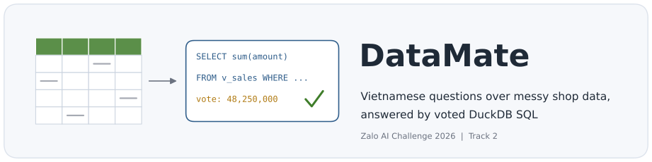
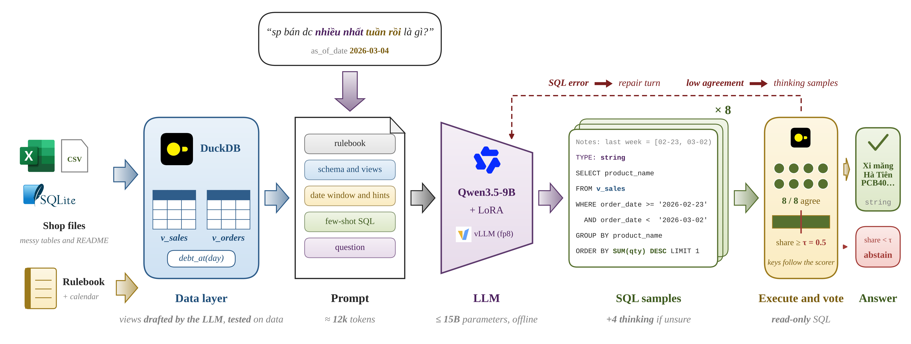
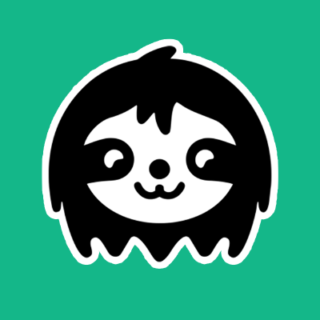

<div align="center">



<p>
  <a href="#results"></a>
  <a href="https://challenge.zalo.ai"></a>
  
  
  
  
  <a href="#docker-private-test-image"></a>
  <a href="LICENSE"></a>
</p>

<p>
  <a href="#installation">Installation</a> &nbsp;|&nbsp;
  <a href="#inference">Inference</a> &nbsp;|&nbsp;
  <a href="#results">Results</a> &nbsp;|&nbsp;
  <a href="#docker-private-test-image">Docker</a> &nbsp;|&nbsp;
  <a href="#notebooks-local-kaggle-and-colab">Notebooks</a>
</p>

</div>

DataMate answers Vietnamese questions about the sales data of individual shops, kept as CSV, XLSX and SQLite files that are
messy in a different way for every shop. For each question it returns a typed answer (number, percent, date, string, list,
table or `unanswerable`), or abstains when it is not sure. The score is Penalized Accuracy: +1 for a right answer, 0 for an
abstention, -1 for a wrong one. This repository holds the team's full solution to Track 2 of the Zalo AI Challenge 2026:
inference, training, evaluation, notebooks and the offline Docker image.

## Highlights

- **0.683 on the public test**, from 0.25 for the first pandas agent, trained only on the organizer's train split.
- **One model, within the limits.** Qwen3.5-9B with one LoRA adapter of our own (9.70B parameters, limit 15B), offline, one
  process per GPU over its share of the shops, each stopping itself at 5 h 50 min to stay within the 6-hour limit.
- **The model writes SQL, DuckDB computes.** Every question gets 8 SQL samples run read-only on normalised data. An answer is
  given only when enough samples agree; otherwise the question is abstained to avoid the penalty.
- **Reproducible.** Notebooks from EDA to LoRA training (run locally and on Kaggle); the Docker image carries the code, the
  training data, logs, checkpoints and a SHA-256 manifest, as the organizer's guide asks.

## Contents

1. [How it works](#how-it-works)
2. [Results](#results)
3. [Requirements](#requirements)
4. [Installation](#installation)
5. [Inference](#inference)
6. [Docker (private-test image)](#docker-private-test-image)
7. [Evaluation and error analysis](#evaluation-and-error-analysis)
8. [Training the LoRA](#training-the-lora)
9. [Notebooks (local, Kaggle and Colab)](#notebooks-local-kaggle-and-colab)
10. [Repository layout](#repository-layout)
11. [Rules we follow](#rules-we-follow)
12. [Acknowledgements](#acknowledgements)

## How it works

<p align="center">
  
</p>

```
questions.jsonl ─┐
data/<shop>/  ───┼─► ingest      load every table into DuckDB, guess headers, normalise dates, amounts and names, profile columns
rulebook.md   ───┘      │
                        ▼
                     views       once per shop: the model writes K draft SELECTs that map the raw data onto canonical tables
                     debts       v_sales / v_orders and a debt layer (macros debt_at, debt_new, debt_repaid); drafts are checked
                        │        against the data (categories, times, units), repaired, and the majority draft is kept
                        ▼
                     hints       date windows, hints by question shape, data values that match the question
                     prompts     2 system prompts x K/2 samples, few-shot examples retrieved from the train example bank
                        │
                        ▼
                     llm         vLLM + LoRA: 8 plain SQL samples, plus 4 thinking samples for hard and debt questions
                     sqlexec     read-only execution with a timeout, typed answers, a failed sample gets a repair turn
                        │
                        ▼
                     voting      group answers the way the scorer compares them, vote, answer when >= 50% of samples agree,
                                 abstain when the winning answer is 0 or empty
                        │
                        ▼
                     submission  write submission.jsonl after every shop (answers survive a stop at the time limit)
```

`datamate/pipeline.py` chains the steps. Each step is its own method, so the prompts and the vote of a saved run can be rebuilt
without a GPU (`analysis/replay_run.py`).

## Results

| Version   | Main change                                                                                        | Public    |
| --------- | -------------------------------------------------------------------------------------------------- | --------- |
| v2        | LoRA v2, few-shot examples, debt macros                                                            | 0.491     |
|           | `qty` in base units, answer `unanswerable` when it wins the vote                                   | 0.516     |
|           | fresh samples, name canonicalisation, unit factors inferred from prices                            | 0.60      |
| v6        | notes before the SQL, debt-macro examples                                                          | 0.63      |
| sql-hints | v6 + hints by question shape, with a synonym list taken from public dish names (dropped in v9)     | 0.696     |
| v8        | LoRA v3 (adds replies from a 27B teacher model, on train only), data checks on the views          | 0.639     |
| **v9**    | v8 + `sql-hints`, vote keys that follow the scorer, debt-layer fixes                               | **0.683** |

`sql-hints` (0.696) is a team member's branch whose synonym list came from public-test dish names. That list was dropped
because it is not derived from the train split, so the official submission is v9. Full history: [docs/leaderboard.md](docs/leaderboard.md).

## Requirements

|          | Minimum                                                 | Used                                                         |
| -------- | ------------------------------------------------------- | ------------------------------------------------------------ |
| GPU      | 24 GB with bf16 support (T4 / P100 do not work)         | 1 x RTX PRO 4000 Blackwell 24 GB; 2 x RTX 5090 for the private run |
| RAM      | 30 GB                                                   | 30 GB                                                        |
| Software | CUDA >= 12.8, Python >= 3.12, `git-lfs`                 | vLLM 0.32.0, DuckDB 2.0.0                                    |
| Disk     | about 20 GB for the base model, about 70 GB to build the Docker image |                                                |

Data loading, scoring, tests and notebooks 01 and 03 need only a CPU.

## Installation

**1. Clone the repository and fetch the LoRA adapter (Git LFS):**

```bash
git clone https://github.com/hugebenevolence/zalo-ai-challenge-datamate-26.git
cd zalo-ai-challenge-datamate-26
git lfs install && git lfs pull          # adapters/sql_rft_v3
```

**2. Create the Python environment:**

```bash
python3 -m venv .venv
.venv/bin/pip install -e ".[llm,dev]"    # CPU only: drop "llm" and use .[dev]
```

**3. Download the base model** (the revision used for the submission, see `docker/model_manifest.json`):

```bash
.venv/bin/hf download Qwen/Qwen3.5-9B --revision c202236235762e1c871ad0ccb60c8ee5ba337b9a --local-dir models/Qwen3.5-9B
```

**4. Put the organizer's data** in `data/` (not in git):

```
data/
├── train/
│   ├── questions.jsonl     {"id", "business_id", "question", "as_of_date"}
│   ├── answers.jsonl       {"id", "type", "answer", "alias"}   (train only)
│   ├── rulebook.md
│   ├── calendar.csv
│   └── data/<shop>/        README.md and the shop's data files
└── public_test/            like train, without answers.jsonl
```

**5. Check the installation:**

```bash
.venv/bin/python -m pytest -q
```

## Inference

Every run uses the flags of the submitted setup in `scripts/flags.sh`. Each GPU runs one process over its share of the shops,
and the shards are merged into one `submission.jsonl`.

```bash
# Public test, reusing the views and debt layers saved by the 0.683 run (configs/public_v9). About 3.5 h on one 24 GB GPU.
bash scripts/run_public.sh runs/public

# Public test, drafting every view and debt layer from scratch, exactly as the private run in Docker does.
FRESH=1 bash scripts/run_public.sh runs/public_fresh

# The 632 holdout questions of train (splits/holdout600.txt), scored in runs/holdout/score.json.
bash scripts/run_holdout.sh runs/holdout

# Check the submission format.
.venv/bin/python -m datamate.submission check runs/public/submission.jsonl --questions data/public_test/questions.jsonl
```

The file to submit is `runs/public/submission.jsonl`. Logs and per-question traces are in `runs/public/shard<i>/`.

Environment variables:

| Variable                | Default                                    | When to change it                              |
| ----------------------- | ------------------------------------------ | ---------------------------------------------- |
| `NUM_GPUS`              | every visible GPU                          | to use only some GPUs                          |
| `GPU_MEM`               | `0.92`                                     | another process shares the GPU (e.g. `0.75`)   |
| `ENGINE`                | see `scripts/flags.sh`                     | out of memory: lower `max_num_seqs`            |
| `MODEL_DIR`, `LORA_DIR` | `models/Qwen3.5-9B`, `adapters/sql_rft_v3` | the model or the adapter lives elsewhere       |
| `PYTHON`                | `.venv/bin/python`                         | another Python environment                     |

`python -m datamate.predict --help` lists every pipeline flag.

> Every run draws new samples, so the same setup can move by about ±1 public point. To compare two setups, compare two full
> runs; do not mix results from several runs.

## Docker (private-test image)

The image follows the organizer's final Docker guide (`zac2026_DataMate_docker_guideline_final.pdf`). Steps 1 and 3 of the
installation must be done first (the LoRA adapter and the base model are copied into the image), and the train data, the SFT
data and the training logs must be on the build machine.

`docker/build.sh` runs the guide's steps (sections 9, 10 and 11):

```bash
TEAM=<team_name> bash docker/build.sh pack       # git lfs pull + build/training_code (code, data, logs, checkpoints, manifest)
TEAM=<team_name> bash docker/build.sh build      # build the image, then print its platform, size and /code tree
TEAM=<team_name> bash docker/build.sh test 10    # the organizer's scoring command on the public test, first 10 questions per GPU
TEAM=<team_name> bash docker/build.sh export     # .tar.gz, uncompressed .tar size (<= 100 GB) and the .md5 file to send
```

The same steps by hand:

```bash
python3 scripts/pack_training_code.py      # build/training_code: code, data, logs, checkpoints, data_manifest.json (SHA-256)
docker build --platform linux/amd64 -f docker/Dockerfile -t zaic2026_datamate_<team_name>:final .
# the organizer's scoring command: 2 GPUs, no network, read-only /data, 16 GB shared memory
docker run --rm --gpus '"device=0,1"' --network none --shm-size=16g --entrypoint bash \
    -v /path/to/split:/data:ro -v "$PWD/result:/result" zaic2026_datamate_<team_name>:final /code/predict.sh
```

- Layout in the image: `/code/predict.sh` (no arguments), `/code/README.md` (the description for the organizers, source in
  `docker/README.md`), `/code/src/datamate`, `/code/models/{Qwen3.5-9B,lora}`, `/code/training_code/` (README from
  `docker/training_code_README.md`).
- `/data` is one split folder like `data/public_test/` (questions.jsonl, rulebook.md, calendar.csv, data/).
- Outputs:
  - `/result/submission.jsonl`, rewritten after every shop, so answers given before a stop still count;
  - `/result/logs/<id>.json`: one record per question, on one line, with `id`, `answer`, `elapsed_ms`, `thinking`, `code`, `output`;
  - `/result/work/`: the views, debt layers and trace of each GPU.
- The container runs offline and always drafts fresh views for every shop; it never uses `configs/public_v9`.
- Each process stops after `TIMEOUT_SECONDS` (default 21,000 s).
- The base image is vLLM 0.32.0, not the 0.10.1.1 the organizers suggest, because 0.10.1.1 cannot run Qwen3.5. The guide allows
  another image as long as it supports the RTX 5090.
- Retraining inside the image: `bash /code/training_code/train.sh` (separate training environment in `/opt/venv-train`).
- Export for submission:
  ```bash
  set -o pipefail
  docker save zaic2026_datamate_<team_name>:final | pigz -p 8 > zaic2026_datamate_<team_name>.tar.gz
  pigz -dc zaic2026_datamate_<team_name>.tar.gz | wc -c                                  # uncompressed .tar size, must be <= 100 GB
  md5sum zaic2026_datamate_<team_name>.tar.gz > zaic2026_datamate_<team_name>.tar.gz.md5
  ```

## Evaluation and error analysis

Train answers are read only by the evaluation tools. The inference code never imports `datamate/scoring.py`.

```bash
# Score a submission on train (or on a subset with --questions)
.venv/bin/python -m datamate.scoring --data data/train --pred RUN/submission.jsonl --output RUN/score.json

# PA, Oracle@K, the step where each question was lost, paired comparison of two runs
.venv/bin/python analysis/err.py RUN [RUN2]
```

| Tool                       | What it does                                                                                                         | Needs labels |
| -------------------------- | -------------------------------------------------------------------------------------------------------------------- | ------------ |
| `analysis/err.py`          | PA, coverage, Oracle@K, the step that lost each wrong question (no right sample, vote, threshold), paired comparison | yes          |
| `analysis/error_matrix.py` | error matrix: question shape x error group, answer type, route (macro, view, raw table), shop, systematic errors    | yes          |
| `analysis/gate_cv.py`      | replays answer-selection rules on traces and picks the threshold by leave-one-shop-out                               | yes          |
| `analysis/flags.py`        | flags per step (shop, question, sample); with labels it names the first step that went wrong                         | optional     |
| `analysis/view_flags.py`   | checks saved views against the raw tables: times, units, customers, statuses, duplicate rows                          | no           |
| `analysis/replay_run.py`   | rebuilds the prompts and the vote of a saved run; a change that keeps behaviour must give 0 differences               | no           |

The holdout (`splits/holdout600.txt`, 6 shops) is no longer clean for LoRA v3, which was trained on some questions of these
shops. With v3, the holdout score is a quick check only, not a way to choose a setup (details in [docs/leaderboard.md](docs/leaderboard.md)).

## Training the LoRA

The easiest path is notebooks `04_training_data` and `05_train_lora`. From the command line, create a separate training
environment:

```bash
python3 -m venv .venv-train
.venv-train/bin/pip install -r training/requirements.txt
.venv-train/bin/pip install fla-core==0.6.0 --no-deps     # Gated DeltaNet kernels
```

Steps:

```bash
# 1. A labelled run on the 24 train shops outside the holdout, keeping the prompts (the input of the SFT data), with the flags of scripts/flags.sh
.venv/bin/python -m datamate.predict --data data/train --ids splits/rft_train24.txt --output runs/train_pool --save-prompts ...

# 2. Keep the right samples as SFT data, then add notes before the SQL
.venv/bin/python training/build_sft.py runs/train_pool --fewshot assets/fewshot_bank.jsonl --out data/sft/sql_rft.jsonl --easy 800 --max 4000
.venv/bin/python training/add_notes.py data/sft/sql_rft.jsonl data/sft/sql_rft_notes.jsonl

# 3. Check that the fla kernels match the PyTorch reference, then continue training from LoRA v3
.venv-train/bin/python training/check_fla.py
.venv-train/bin/python training/train_lora.py data/sft/sql_rft_notes.jsonl --out runs/lora/sql_rft_v4 --model models/Qwen3.5-9B \
    --init-adapter adapters/sql_rft_v3 --max-len 32768 --r 16 --alpha 32 --lr 5e-5 --epochs 1 --grad-accum 8 --end '<|im_end|>' \
    --no-thinking --completion-logits [--resume]
```

Notes:

- An SFT row is 9k to 19k tokens long, because the prompt holds the rulebook and the shop's schema. A `--max-len` below about
  16k drops most of the data.
- `training/build_fewshot_bank.py` rebuilds `assets/fewshot_bank.jsonl`; `training/merge_lora.py` merges the LoRA into the base
  model.

## Notebooks (local, Kaggle and Colab)

| Notebook           | What it does                                                                                     | Needs                       |
| ------------------ | ------------------------------------------------------------------------------------------------ | --------------------------- |
| `00_full_pipeline` | the five parts below in one notebook (assembled by `scripts/build_full_notebook.py`)             | as each part                |
| `01_eda`           | shops, files, answer types, question shapes, rulebook differences, one shop after loading        | CPU                         |
| `02_inference`     | runs the pipeline on a split (a few questions or all of it), merges and checks the submission, scores train runs | bf16 GPU >= 24 GB |
| `03_evaluation`    | scores by type, shop and question shape, error groups, threshold, Oracle@K, label-free comparison of submissions | CPU       |
| `04_training_data` | SFT data from a labelled train run, notes before the SQL, statistics                             | CPU, GPU for the notes step |
| `05_train_lora`    | checks the fla kernels, trains the QLoRA (resumable when a session drops), loss curve            | GPU                         |

- Run them in order, 01 to 05 (or `00_full_pipeline` from top to bottom). The first cell detects local, Kaggle or Colab.
- Each notebook has a `parameters` cell and runs with papermill: `papermill notebooks/02_inference.ipynb out.ipynb -p LIMIT 10`.
- All five notebooks ran locally (24 GB GPU). `00_full_pipeline` ran to the end on Kaggle (CPU). The Colab branch is untested.
- Without a bf16 GPU of 24 GB or more (Kaggle T4 / P100, CPU), the steps that need the model (inference in 02, notes in 04,
  training in 05) use results saved from a 24 GB GPU in `runs/saved/` of the attached repository copy (not in git), so the
  notebooks still run to the end and draw the results. `DATAMATE_NO_GPU=1` simulates this case on a GPU machine.
- To keep a copy with outputs (for teaching, say) while the repository stays clean:
  `python scripts/execute_notebooks.py --out <folder outside the repo> 01_eda 03_evaluation` (change parameters with
  `--set LIMIT=20`), then `python scripts/build_full_notebook.py --from-dir <that folder> --out <that folder>/00_full_pipeline.ipynb`.
- Notebooks are committed **without outputs** (outputs contain competition data); `tests/test_notebooks.py` checks this. Before
  committing: `jupyter nbconvert --clear-output --inplace notebooks/*.ipynb`.

On Kaggle:

1. **Settings:** turn Internet on and pick a GPU accelerator for 02, 04 and 05. The base model is downloaded to `/tmp/models`
   in every session (about 19 GB). Results go to `/kaggle/working/runs` and persist after the session.
2. **Code:** attach a dataset that is a copy of the repository (with the real `adapters/` and the `runs/` that 03 and 04 read).
   The first cell uses it when present. Otherwise add a `GITHUB_TOKEN` (a token that can read the repository) under
   **Add-ons > Secrets**, and the first cell clones the repository and fetches the LoRA with Git LFS.
3. **Data:** add a dataset with `train/` and `public_test/` laid out like `data/` above. The notebooks find it in `/kaggle/input`.
4. **Session limits:** `05_train_lora` saves a checkpoint every `SAVE_STEPS` steps; set `RESUME = True` to continue. Training on a
   16 GB GPU is untested. For learning only, set `MAX_LEN = 16384` and a small `LIMIT_ROWS`.

On Colab:

1. **Drive:** create `MyDrive/datamate/` with `code/` (a copy of the repository, as for the Kaggle dataset above) and `data/`
   (with `train/` and `public_test/`). Without `code/`, add a `GITHUB_TOKEN` secret (key icon, grant the notebook access) and
   the first cell clones the repository.
2. **Runtime:** a GPU for 02, 04 and 05 (bf16, 24 GB or more, e.g. A100 or L4). The first cell mounts Drive. The base model is
   downloaded to `/content/models`; results are kept in `MyDrive/datamate/runs`.
3. **05_train_lora:** run it in its own session (its training stack differs from the vLLM stack of 02 and 04), as on Kaggle.

## Repository layout

```
datamate/                 inference package (python -m datamate.predict)
  predict.py              CLI: reads the flags, starts the model, runs the Pipeline
  pipeline.py             the steps: load shop -> views / debts -> prompts -> samples -> vote -> write results
  llm.py                  vLLM wrapper (the only file that imports vllm)
  ingest.py               loads and normalises shop data, profiles columns
  views.py, debts.py      canonical tables v_sales / v_orders and the debt layer: draft, check, choose, describe
  hints.py, prompts.py    hints from the question, system prompts, user message, repair hints
  sqlexec.py, voting.py   runs one SQL sample; votes and decides whether to answer
  fewshot.py              train example bank and retrieval
  scoring.py              Penalized Accuracy as the published rules define it (not used at inference)
  submission.py           writes, merges shards and checks the submission format
  values.py               filter values that are not in the data (for analysis/flags.py)
  notebook.py             shared notebook code: paths, GPU capability, step-by-step runs with logs
scripts/                  run_public.sh, run_holdout.sh, flags.sh (flags of the submitted setup), pack_training_code.py (training_code for Docker)
docker/                   Dockerfile, predict.sh (entry point /code/predict.sh), README.md (= /code/README.md), train.sh and
                          training_code_README.md (in /code/training_code), requirements.txt, model_manifest.json, build.sh
training/                 SFT data, notes, few-shot bank, LoRA training, fla kernel check, LoRA merge
analysis/                 offline evaluation tools (table above)
notebooks/                00_full_pipeline (all five parts), 01_eda -> 02_inference -> 03_evaluation -> 04_training_data -> 05_train_lora
configs/public_v9/        views and debt layers of the 0.683 run (only to rerun the public test)
assets/fewshot_bank.jsonl example bank: train questions and their right SQL
adapters/sql_rft_v3/      LoRA v3 (Git LFS)
splits/                   id lists: holdout600, holdout_shops, val300, smoke6, rft_train24
tests/                    pytest, CPU only
docs/                     challenge description, data notes, score history, figures
```

Not in the repository: `data/` (the organizer's data), `models/` (base weights), `runs/` (run outputs, logs, checkpoints).

## Rules we follow

- Offline inference, no human in the loop, at most 15B parameters in total (Qwen3.5-9B, Apache-2.0, + a 43M LoRA).
- No logic keyed on question or shop ids. `configs/public_v9` is used only to rerun the public test; the Docker image for the
  private test always drafts fresh views.
- No training on test data; any extra annotation was made on train only (§4.2). Prompt hints are rulebook rules or general
  Vietnamese knowledge, checked against the train answers. Anything that only matched public questions (synonyms from public
  dish names, product-line hints) was removed.
- The whole private test runs within 6 hours on 2 x RTX 5090, and every question's log is kept for the re-run (Rule 8, gap at most
  0.03).

## Documentation

- [Challenge](docs/challenge.md)
- [Data notes](docs/data-notes.md)
- [Score history](docs/leaderboard.md)

## Acknowledgements

<p>
  &nbsp;&nbsp;
  &nbsp;&nbsp;
  &nbsp;&nbsp;
  &nbsp;&nbsp;
  
</p>

Built on [Qwen3.5](https://huggingface.co/Qwen/Qwen3.5-9B), [vLLM](https://github.com/vllm-project/vllm),
[DuckDB](https://duckdb.org), [Unsloth](https://github.com/unslothai/unsloth) and
[flash-linear-attention](https://github.com/fla-org/flash-linear-attention). Thanks to the Zalo AI Challenge 2026 organizers
for the data and the rulebook.

Team: Dương Trường Bình, Tô Phát Đạt, Trần Đại Nhân.

## License

The code, the LoRA adapter and the example bank in this repository are under the [MIT License](LICENSE). The Qwen3.5-9B model is
downloaded separately and is under Qwen's Apache-2.0 license. The organizer's data is not in this repository and is not covered by
this license.
